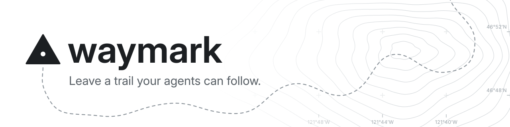

<p align="center">
  <picture>
    <source media="(prefers-color-scheme: dark)" srcset="docs/assets/banner-dark.svg">
    <source media="(prefers-color-scheme: light)" srcset="docs/assets/banner-light.svg">
    
  </picture>
</p>

<p align="center">
  <a href="https://github.com/noahnkr/waymark/actions/workflows/ci.yml"></a>
  <a href="https://pypi.org/project/waymark-cli/"></a>
  
  <a href="LICENSE"></a>
</p>

Waymark is spec-driven development built on **living specs**: plain markdown in
your repository that says what your system does today. Every change starts as an
edit to those specs, and nothing is built until you've approved it. Then each
task goes to a fresh agent that works from the written change alone, and the
riskier ones are checked by a second agent that never saw how they were built.
A small command-line tool, `wm`, keeps track of where it all stands.

## See it in action

<!-- generated: evidence -->

```text
# /wm-explore (optional): think the idea through with the agent

$ wm new change add-result-limit
Created the change "add-result-limit" with a proposal to draft.

# /wm-propose: the agent drafts the proposal, a spec delta, the design
# and the task list, with a review level for each task

$ wm status
── Changes in flight ───────────────────────────────────────────────────
  add-result-limit         planned    ░░░░░░░░░░ 0/2    ◆ accept (you)

◆ 1 thing needs you: wm inbox

$ wm accept add-result-limit
Accepted "add-result-limit". Its items can now be applied.

# /wm-apply: a fresh agent builds 1.1 from the change alone and ends with
#   RESULT: done: capped after sorting; the fifty-one-match test passes
# A reviewer agent that never saw the build checks it and ends with
#   VERDICT: pass: cap and order hold; the scenario is covered by the test
# wm writes both under 1.1. Then 1.2 is built; it needs no review.

$ wm status
── Changes in flight ───────────────────────────────────────────────────
  add-result-limit         applied    ██████████ 2/2    ◆ archive (you)

◆ 1 thing needs you: wm inbox

$ wm archive add-result-limit --outcome "Searches return the fifty best matches."
Archived "add-result-limit" as changes/archive/2026-01-15-add-result-limit. Its deltas are now part of the specs.
```

The files behind it, all plain markdown in `waymark/`:

<details>
<summary><code>changes/add-result-limit/proposal.md</code></summary>

```markdown
# Add a result limit

Owner: Alex Example
Accepted: 2026-01-15 by Alex Example (fingerprint: 6cec39a287bf99f2)

## Why

Searches that match thousands of documents return all of them,
and the results page slows to a crawl.

## What changes

A search returns at most fifty results, best matches first.

## Non-goals

Paging through the rest.

## Impact

Specs: search.
```

</details>
<details>
<summary><code>changes/add-result-limit/specs/search.md</code>, the spec delta</summary>

```markdown
# Search

## Purpose

How a search finds and returns documents.

## Added requirements

### Requirement: Result limit
A search SHALL return at most fifty results.

#### Scenario: Many matches
- GIVEN an index where a query matches more than fifty documents
- WHEN the search runs
- THEN the fifty best matches come back
```

</details>
<details>
<summary><code>changes/add-result-limit/design.md</code></summary>

```markdown
# Design

## Context

Results are sorted by relevance before they are returned.

## Approach

Cut the sorted list at fifty, in the search service.

## Decisions

### Decision: Where to cut

- Options: in the database query, or after sorting
- Choice: after sorting
- Why: the order has to be final before the cut

## Risks and trade-offs

Sorting every match still costs memory on very large result sets.
```

</details>
<details>
<summary><code>changes/add-result-limit/tasks.md</code>, with what wm recorded</summary>

```markdown
# Tasks

## 1. Limit

- [x] 1.1 Cap the result count   `review: independent`
  - Criteria: at most fifty results come back, best first
  - Verify: a test searches an index with fifty-one matches
  - (review) 2026-01-15 pass: cap and order hold; the scenario is covered by the test
- [x] 1.2 Name the limit in the help text   `review: none`
  - Criteria: the search help says fifty
```

</details>
<details>
<summary><code>specs/search.md</code>, the living spec after archive</summary>

```markdown
# Search

## Purpose

How a search finds and returns documents.

## Requirements

### Requirement: Result limit
A search SHALL return at most fifty results.

#### Scenario: Many matches
- GIVEN an index where a query matches more than fifty documents
- WHEN the search runs
- THEN the fifty best matches come back
```

</details>

<sub>Real output of this version of <code>wm</code> on a generic change, generated by <code>tools/docs.py</code>. The comments mark where an agent works.</sub>

<!-- end of generated evidence -->

## Why Waymark

- **Agents only know what's written down.** Each task is built by a fresh agent
  from the written change alone. When something is missing, it reports a spec
  gap instead of guessing.
- **Review is recorded.** Each task is checked against its criteria, by your
  session for routine work or by an independent reviewer agent that never saw
  the build, and the result is written right under the task.
- **Pick up anywhere.** `wm` works out where things stand from the files and
  git, in any session, on any machine.
- **Two sign-offs, both yours.** Agents draft every file and write the code. You
  approve each change before it's built, and again when it's archived.
- **Light for small changes, thorough for big ones.** A small change takes the
  short path: a proposal, a task list and a quick self-check. A bigger one adds
  a design, and its riskier tasks get a second agent as an independent reviewer.

In Claude Code, these rules are enforced by hooks, not just asked for. See
[what's enforced, and where](#whats-enforced-and-where).

## Quick start

```
pipx install waymark-cli     # or: uv tool install waymark-cli
cd your-project
wm init
```

Then, in Claude Code:

- **`/wm-kickoff`** drafts your project's charter with you.
- **`/wm-onboard`** takes one real, small change on your own code through every step.

From then on: `/wm-propose` to start a change, `/wm-apply` to build it,
`/wm-archive` to finish it. `wm status` shows where things stand, and `wm inbox`
shows what needs you. Note that the package is `waymark-cli`; the command is `wm`.

<details>
<summary><strong>Who it's for</strong></summary>

<br>

- **Solo developers** building real projects with coding agents.
- **Small teams** (roughly two to five) sharing one record across branches.
- **Projects split across repositories,** such as a frontend and a backend, with
  one record in an *atlas* ([guide](docs/multi-repo.md)).
- **New and existing codebases.** Specs grow where work happens; nothing is
  reverse-engineered up front.

It's not for handing over a goal and walking away, for throwaway scripts, or for
organizations that need access control or approval chains.

</details>

<details>
<summary><strong>What it costs</strong></summary>

<br>

Agents write every artifact and all the code, on your own agent tool and plan;
`wm` never calls a model. You approve each change twice, and settle what
`wm inbox` lists: spec gaps, blocked items, reviews that failed twice. Time and
token figures will come from using Waymark on itself, in 0.1.1. None are
claimed before they're measured.

</details>

<details>
<summary><strong>What's enforced, and where</strong></summary>

<br>

| Enforced by | What | Holds in |
|---|---|---|
| `wm`, the git hooks and CI | Nothing is built before acceptance; archive refuses unbuilt or unreviewed items; conflicting changes are caught; record health; commit-message format | Every agent tool |
| Claude Code's hooks | Only you accept a change or override a missing review; implementers edit only code (in their item's repo) and their notes; reviewers edit nothing; delegated agents can't commit, push or write the record; results are recorded from the agents' own words | Claude Code |

These are guard rails against mistakes and shortcuts, not security against
someone set on getting around them.

**Teams:** each change has one owner and its own branch. Two changes that touch
the same requirement are reported, and the second must be revised before it's
archived. Conflicts are caught on the merged tree, not before merge. The
independent reviewer is always an agent.

</details>

## Learn more

- **[Getting started](docs/getting-started.md)**: from install to your first change
- **[Concepts](docs/concepts.md)**: the workflow, the files, the roles, and a glossary
- **[Multi-repo guide](docs/multi-repo.md)**: one record for several repositories
- **[CLI](docs/cli.md)** and **[JSON](docs/json.md)** references, generated from the code
- **[Architecture](docs/architecture.md)**: for contributors, including how to add an agent tool
- **[Changelog](CHANGELOG.md)**

Works with Claude Code. Version last verified: **pending the 0.1.0 smoke test**.

## License

[MIT](LICENSE)
