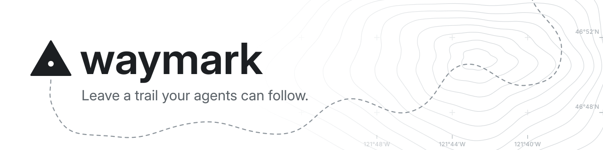

<p align="center">
  <picture>
    <source media="(prefers-color-scheme: dark)" srcset="docs/assets/banner-dark.svg">
    <source media="(prefers-color-scheme: light)" srcset="docs/assets/banner-light.svg">
    
  </picture>
</p>

<p align="center">
  <a href="https://github.com/noahnkr/waymark/actions/workflows/ci.yml"></a>
  <a href="https://pypi.org/project/waymark-cli/"></a>
  
  <a href="LICENSE"></a>
</p>

Waymark is spec-driven development for coding agents, anchored in **living
specs**: plain markdown in your repository that says what your system does
today. Facts an agent can't get from the code, about the services, platforms and
accounts your system depends on, are kept as **resources** linked to the specs
they serve. Each change starts as a written plan that edits the specs, is built
from that plan, and becomes part of the specs when it's done. A small
command-line tool, `wm`, keeps track of where everything stands.

## The trail of a change

<p align="center">
  <picture>
    <source media="(prefers-color-scheme: dark)" srcset="docs/assets/trail-dark.svg">
    <source media="(prefers-color-scheme: light)" srcset="docs/assets/trail-light.svg">
    
  </picture>
</p>

## How it works

Every piece of work takes one of three paths, depending on how much it changes
the specs:

| Path | When | What gets written |
|---|---|---|
| **Tiny** | The specs don't change: a typo, a docs fix, a bug, a refactor | Nothing. You say yes, the agent fixes it, you review the pull request. |
| **Short** | The specs change, but there's nothing to design | A short plan: what's changing and why, the spec edits, and a task list. |
| **Full** | The specs change and there are decisions to make | The same plan plus a design, and you agree every decision before anything gets built. |

Here's how a change goes:

- **Explore**, if you're not sure yet. `/wm-explore` talks the idea through with
  you, using what the specs already say, and writes nothing unless you ask. It
  can save your thinking for later, or turn it into a change or a milestone.
- **Propose.** `/wm-propose` looks at your specs and code to see what the work
  involves. If it's tiny, it tells you in one line what it'll change and does it
  once you say yes. Otherwise it asks what it needs to know, then writes the
  plan: why, the spec edits, a design if there is one, and a task list where
  every task says how you'll know it's done.
- **Accept.** You read a short summary and run `wm accept`. Nothing is built
  before that.
- **Apply.** `/wm-apply` builds the tasks one at a time and commits each one.
  Then it checks the whole change against the plan. For a risky change, a second
  agent that never saw the build does the check.
- **Archive.** `/wm-archive` folds the spec edits into your specs and notes what
  was built. You run the command; it's your second sign-off.
- **Merge.** `/wm-pr` opens a pull request with the code and the updated specs,
  once you say yes. You merge it.

**Bigger goals** that take several changes get a **milestone**
(`wm new milestone <name>`): the goal, how you'll know it's reached, and a
roadmap of the changes. As each change is archived its line is ticked, and
`wm status` shows the progress until you close it.

At any point, `wm status` shows where things stand and what's waiting on you.
[Concepts](docs/concepts.md) covers the whole workflow.

## Quick start

```bash
pipx install waymark-cli        # or: uv tool install waymark-cli
cd your-project && git init     # skip git init in an existing repository
wm init                         # adds the record, plus skills, agents and hooks for Claude Code
```

Then, in Claude Code:

- **`/wm-kickoff`** interviews you for the project's charter, one section at a time.
- **`/wm-onboard`** takes one real, small change on your own code through every step.

The package is `waymark-cli`; the command is `wm`. Commit `waymark/` and
`.gitignore`; the skills, agents and hooks are set up per machine.

<details>
<summary><strong>Setting up a new or existing project, in one repository or several</strong></summary>

<br>

| | One repository | Several repositories |
|---|---|---|
| **New project** | `git init`, then `wm init`. Run `/wm-kickoff`; your first change creates the first specs. | Make an **atlas**: a repository of its own that holds the record, beside the others. Run `wm init --atlas <name>` in it, list the other repositories in `waymark/config.toml`, then run `wm atlas register`. |
| **Existing project** | `wm init` in the repository; your code isn't touched. There's nothing to write up front: a spec starts the first time a change touches that part of the code. | The same atlas setup, beside the repositories you already have. They don't need any Waymark files. |
| **Joining a project that uses Waymark** | Install the version pinned in `waymark/config.toml`, then run `wm init`. It sets up your machine and changes nothing in the record. | Clone the atlas and the repositories side by side, then run `wm init` and `wm atlas register` in the atlas. |

A **monorepo** counts as one repository: one record, with a spec for each part
of the system. List your packages in `commit_scopes` in `waymark/config.toml`.

Step by step: [Getting started](docs/getting-started.md) and the
[multi-repo guide](docs/multi-repo.md).

</details>

## Skills

You work through skills, as slash commands in Claude Code:

| Skill | Use it to |
|---|---|
| `/wm-kickoff` | Write the project's charter with you, once per project |
| `/wm-onboard` | Take a first change all the way through, explaining each step |
| `/wm-explore` | Think a fuzzy idea through, without writing anything |
| `/wm-propose` | Do any piece of work: a small fix after your yes, or the plan for a change |
| `/wm-update` | Revise a plan, settle a decision, or fill a gap |
| `/wm-apply` | Build an approved change, then check it |
| `/wm-archive` | Finish a change and update the specs |
| `/wm-pr` | Open the pull request, once you say yes |

Each task's `- **Build:**` line names who builds it: `planner` for your
session, which builds most tasks; `implementer` for a fresh agent that builds it
from the plan alone; or `human` for work only you can do, such as a manual test
or setting up a platform, which your session hands to you and ticks after your
yes. `/wm-apply` starts the implementer, and a reviewer that checks a risky
change. [Skills and agents](docs/skills.md) covers what each one reads, writes
and shows you.

## See it in action

Adding dark mode to an app, from the first question to the pull request. Lines
starting with `>` are what you type to your agent, and lines starting with `$`
are commands you run. The output is real.

<!-- generated: evidence -->

```text
> /wm-explore People keep asking for dark mode. What would it take?

> /wm-propose Let's add it: follow the device's setting, with a choice in Settings.

$ wm status
── Changes in flight ───────────────────────────────────────────────────
  add-dark-mode            planned    ░░░░░░░░░░ 0/3    ◆ accept (you)

◆ 1 thing needs you: wm inbox

$ wm accept add-dark-mode
Accepted "add-dark-mode". Its items can now be applied.

> /wm-apply

$ wm status
── Changes in flight ───────────────────────────────────────────────────
  add-dark-mode            applied    ██████████ 3/3    ◆ archive (you)

◆ 1 thing needs you: wm inbox

> /wm-archive

> /wm-pr
```

After the archive, the record holds the new spec and the whole change, all plain
markdown in your repository:

```text
waymark/
  charter.md                                  what the project is, its goals and its rules
  config.toml                                 settings, and the pinned wm version
  changes/
    archive/
      2026-01-15-add-dark-mode/
        design.md                             how it's built, and the decisions
        proposal.md                           why, what changes, and the outcome
        tasks.md                              the tasks, and what wm recorded
        specs/
          appearance.md                       the change to the spec
  explorations/
  milestones/
  resources/
  specs/
    appearance.md                             the living spec, now with dark mode
```

<details>
<summary><code>changes/archive/2026-01-15-add-dark-mode/proposal.md</code></summary>

```markdown
# Add dark mode

- **Owner:** Alex Example
- **Review:** self

## Why

People use the app at night, and the bright white screen is hard on the eyes.
Dark mode is the most requested feature.

## What changes

The app gets a dark theme. It follows the device's setting by default, and a
Theme choice in Settings lets people pick light, dark or system.

## Non-goals

Custom colors, or themes beyond light and dark.

## Impact

- **Specs:** `appearance` (new)
- **User-visible:** a dark theme, and a Theme choice in Settings
- **Code:** the stylesheet and the settings page

## Outcome

- **Built:** A dark theme that follows the device, and a Theme choice in Settings.
- **Differs:** none
```

</details>
<details>
<summary><code>changes/archive/2026-01-15-add-dark-mode/design.md</code></summary>

```markdown
# Design

## Context

Colors are written out across the stylesheet, and Settings has no appearance
section yet.

## Approach

Move every color into CSS variables, defined once for light and once for dark,
and pick the set from a `data-theme` attribute on the page. The Theme setting
stores light, dark or system.

## Decisions

### Decision: Default theme

- **Status:** decided
- **Decided by:** human
- **Options:**
  - follow the device's setting;
  - always start light.
- **Choice:** follow the device's setting.
- **Why:** people who run their device dark expect apps to match without asking.

## Open questions

None.

## Risks and trade-offs

Embedded widgets that set their own colors won't switch; they're left for a
later change.
```

</details>
<details>
<summary><code>changes/archive/2026-01-15-add-dark-mode/specs/appearance.md</code>, the change to the spec</summary>

```markdown
# Appearance

## Purpose

How the app looks, and the choices people have over it.

## ADDED Requirements

### Requirement: Dark theme
The app SHALL offer a light and a dark theme, and SHALL follow the device's
setting until the person picks one.

#### Scenario: Device set to dark
- GIVEN a device set to dark mode, and no theme picked in the app
- WHEN the app opens
- THEN it shows the dark theme

#### Scenario: Theme picked in Settings
- GIVEN a device set to dark mode
- WHEN the person picks Light under Settings, Theme
- THEN the app shows the light theme, and still does the next time it opens
```

</details>
<details>
<summary><code>changes/archive/2026-01-15-add-dark-mode/tasks.md</code>, with what wm recorded</summary>

```markdown
# Tasks

## 1. Dark mode

- [x] 1.1 Move the colors into theme variables
  - **Build:** planner
  - **Criteria:** every color in the stylesheet comes from a variable with a light and a dark value
  - **Verify:** a search of the stylesheet finds no colors written out
- [x] 1.2 Follow the device's setting
  - **Build:** planner
  - **Criteria:** with no theme picked, the app matches the device's light or dark mode
  - **Verify:** a test for the scenario "Device set to dark"
- [x] 1.3 Add the Theme choice to Settings
  - **Build:** planner
  - **Criteria:**
    - Settings offers light, dark and system
    - the choice is kept between visits
  - **Verify:** a test for the scenario "Theme picked in Settings"

## Log

- 2026-01-15 (accepted) fingerprint f80bacd71e28d538 items 1.1, 1.2, 1.3 by Alex Example
- 2026-01-15 (self-review) covers 1.1, 1.2, 1.3 by planner for Alex Example: every criterion holds, and both scenarios have a test
```

</details>
<details>
<summary><code>specs/appearance.md</code>, the living spec after the archive</summary>

```markdown
# Appearance

## Purpose

How the app looks, and the choices people have over it.

## Requirements

### Requirement: Dark theme
The app SHALL offer a light and a dark theme, and SHALL follow the device's
setting until the person picks one.

#### Scenario: Device set to dark
- GIVEN a device set to dark mode, and no theme picked in the app
- WHEN the app opens
- THEN it shows the dark theme

#### Scenario: Theme picked in Settings
- GIVEN a device set to dark mode
- WHEN the person picks Light under Settings, Theme
- THEN the app shows the light theme, and still does the next time it opens
```

</details>

<!-- end of generated evidence -->

[The record](docs/record.md) explains each of these files, and everything else
that can go in them.

## Why Waymark

- **The specs stay true.** Each change edits the specs, and its edits become
  part of them when it's done, so they always say what your system does today.
- **Agents work from what's written.** Each change starts as a short written
  plan: what's changing, why, and how you'll know it works. Your agent builds
  from that, the specs and the resources. If something's missing, it asks or
  writes it down instead of guessing.
- **Every change gets checked.** When it's built, the whole change is checked
  against the plan, and what the check found stays with the change.
- **Pick up anywhere.** Everything lives in files in your repository, so any
  session on any machine can see where things stand.
- **Light for small work, thorough for big work.** A typo is just a commit. A
  risky change gets a design and a second agent to review it.

<details>
<summary><strong>Who it's for</strong></summary>

<br>

- **Solo developers** building real projects with coding agents.
- **Small teams** sharing one record across branches.
- **Projects split across repositories,** such as a frontend and a backend, with
  one record in an *atlas* ([guide](docs/multi-repo.md)).
- **New and existing codebases.** Specs grow where the work happens; nothing is
  written up front.

It's not for handing an agent a goal and walking away, for throwaway scripts, or
for organizations that need access control or approval chains.

</details>

<details>
<summary><strong>What's enforced, and where</strong></summary>

<br>

**Everywhere, by `wm` itself and in CI:**

- Nothing is built until you accept the change.
- A change can't be accepted while a design decision or question is still open.
- A change can't be archived until every task is done and the change has been checked.
- A check can't pass while it lists a critical problem.
- Two changes that edit the same part of a spec are flagged before the second is archived.
- `wm check`, run in CI, keeps every file in the record well formed.

**In Claude Code, by its hooks:**

- Only you can accept a change, or archive one that skipped its check.
- An agent building a handed-off task can edit only code for that task, in that
  task's repository, and leave notes.
- The reviewer agent can't edit anything.
- Agents started for one task or one review can't commit, push or edit the record.
- Commit messages have to follow the conventional commits format.
- What an agent reports is recorded in its own words.

These catch mistakes and shortcuts. They aren't a security boundary against
someone set on getting around them.

**Teams:** each change has one owner and its own branch, and two changes that
edit the same requirement are caught once both are on the same branch. See
[Working as a team](docs/concepts.md#working-as-a-team).

</details>

<details>
<summary><strong>What it costs</strong></summary>

<br>

- **Money:** nothing extra. Agents run on your own agent tool and plan, and `wm`
  never calls a model or goes online.
- **Tokens:** most of the work happens in your normal session, which already
  knows the change. A fresh agent, which has to read the plan from scratch, is
  only started for an `implementer` task or for checking a risky change.
- **Your time:** answering the agent's questions while it writes the plan,
  approving each change twice, and settling what `wm inbox` lists, such as a
  gap in the plan or a blocked task.

</details>

## Documentation

**Start here**

- **[Getting started](docs/getting-started.md)**: from install to your first change
- **[Concepts](docs/concepts.md)**: the workflow, the paths, the roles, review, and a glossary
- **[Multi-repo guide](docs/multi-repo.md)**: one record for several repositories

**Reference**

- **[The record](docs/record.md)**: every file, what goes in it, and how it's checked
- **[Skills and agents](docs/skills.md)**: what each one does, reads and writes
- **[CLI](docs/cli.md)** and **[JSON](docs/json.md)**: every command and its output, generated from the code
- **[Changelog](CHANGELOG.md)**

**Contributing**

- **[Architecture](docs/architecture.md)**: how `wm` is built, and how to add an agent tool
- **[Smoke test](docs/smoke-test.md)**: the manual walk-through before a release

Works with Claude Code. Version last verified: **2.1.328**, on Windows.

## License

[MIT](LICENSE)
