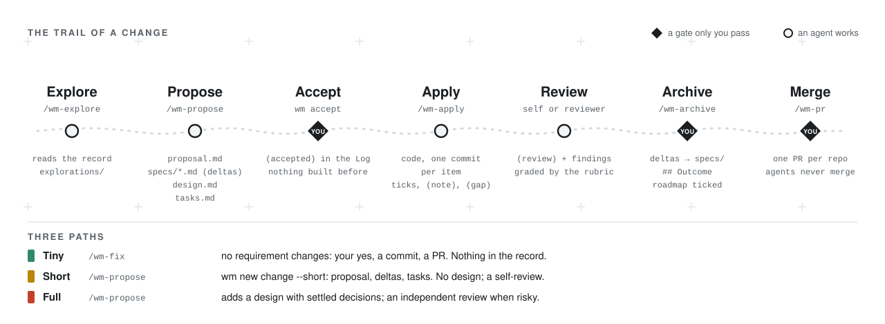

<p align="center">
  <picture>
    <source media="(prefers-color-scheme: dark)" srcset="docs/assets/banner-dark.svg">
    <source media="(prefers-color-scheme: light)" srcset="docs/assets/banner-light.svg">
    
  </picture>
</p>

<p align="center">
  <a href="https://github.com/noahnkr/waymark/actions/workflows/ci.yml"></a>
  <a href="https://pypi.org/project/waymark-cli/"></a>
  
  <a href="LICENSE"></a>
</p>

Waymark is spec-driven development for coding agents, built on **living specs**:
plain markdown in your repository that says what your system does today. Every
change starts as an edit to those specs, and nothing is built until you approve
it. Your agent then builds the change from what's written, the whole change is
reviewed once, and its edits merge into the specs when you archive it. A small
command-line tool, `wm`, checks the record and says what comes next.

<p align="center">
  <picture>
    <source media="(prefers-color-scheme: dark)" srcset="docs/assets/trail-dark.svg">
    <source media="(prefers-color-scheme: light)" srcset="docs/assets/trail-light.svg">
    
  </picture>
</p>

## How it works

Every piece of work takes the path its size needs. The test is what it does to
the specs, not how many lines it takes:

| Path | When | What's written | Run |
|---|---|---|---|
| **Tiny** | No requirement changes: a typo, docs, a bug the specs already describe, a refactor | Nothing in the record; your yes, a commit, a pull request | `/wm-fix` |
| **Short** | A small change with no design | A proposal, spec deltas and a task list; a self-review | `/wm-propose` |
| **Full** | A change that needs a design | All of that plus a design whose decisions you settle; an independent reviewer when it's risky | `/wm-propose` |

On a change, agents draft and build; you pass three gates:

1. **Propose.** `/wm-propose` asks what the record doesn't settle, then drafts
   the proposal, the deltas to the specs, the design and the task list, and
   checks them against each other.
2. **Accept** <sub>you</sub>. You read a short summary and run
   `wm accept <change>`. Nothing is built before this.
3. **Apply and review.** `/wm-apply` builds each item from the record, ticks
   and commits it, then reviews the whole change once, grading findings by one
   severity rubric. A risky change gets a second agent that never saw the build.
4. **Archive** <sub>you</sub>. `/wm-archive` merges the deltas into the specs and
   writes what was built, on the change's branch.
5. **Merge** <sub>you</sub>. `/wm-pr` opens one pull request with the code, the
   specs and the archived change. Agents never merge.

At any point, `wm status` shows where things stand and `wm instructions` says
what comes next. For the whole story, read [Concepts](docs/concepts.md).

## Quick start

```bash
pipx install waymark-cli        # or: uv tool install waymark-cli
cd your-project && git init     # skip git init in an existing repo
wm init                         # the record, plus skills, agents and hooks for Claude Code
```

Then, in Claude Code:

- **`/wm-kickoff`** interviews you for the project's charter, one section at a time.
- **`/wm-onboard`** takes one real, small change on your own code through every step.

The package is `waymark-cli`; the command is `wm`. Commit `waymark/` and
`.gitignore`; the skills, agents and hooks are per machine.

<details>
<summary><strong>New code, existing code, or several repositories?</strong></summary>

<br>

| You have | Do this |
|---|---|
| **A new project** | As above. The first change's deltas create the first specs. For a big first version, start a milestone: `wm new milestone <name>`. |
| **An existing codebase** | As above. You don't spec the whole codebase first: a spec is born the first time a change touches that area. `/wm-kickoff` reads the repo for its Context. |
| **A monorepo** | One record at the top, one spec per area. List your packages in `commit_scopes` in `waymark/config.toml`. |
| **Several repositories** | Put the record in an *atlas*, a repo of its own beside the code: `wm init --atlas <name>`, name the repos in `config.toml`, then `wm atlas register`. Each task item names its repo. See the [multi-repo guide](docs/multi-repo.md). |
| **A clone of a project that uses Waymark** | Install the pinned version from `waymark/config.toml`, then `wm init`. It sets up your machine and changes nothing in the record. |

Step by step: [Getting started](docs/getting-started.md).

</details>

## What's in the record

Everything lives in plain markdown in `waymark/`, committed with your code:

```text
waymark/
  config.toml                 settings: the pinned wm version, review level, commit scopes
  charter.md                  vision, numbered goals and constraints, glossary, context, rules per step
  specs/<area>.md             one living spec per area: requirements, each with scenarios
  changes/<change>/
    proposal.md               why, what changes, non-goals, impact; the outcome at archive
    specs/<area>.md           deltas: requirements added, modified, removed or renamed
    design.md                 how it's built, and each decision with who made it (full path)
    tasks.md                  items with criteria and a way to verify; then a Log wm writes
  changes/archive/            archived changes, each in a dated folder
  milestones/<name>/          milestone.md: a goal and a roadmap of changes
  explorations/<name>.md      saved thinking, with a status
```

What you and your agents write are sections and `- Label:` lines. What `wm`
writes is a dated record, such as `(accepted) 2026-01-15 … by Sam`, and only
`wm` writes those. `wm check` holds every note to its layout.
**[The record](docs/record.md)** covers each note: its sections, the lines it
can hold, the checks, and who updates it.

## Skills and agents

| | Use it to |
|---|---|
| `/wm-kickoff` | Draft the charter and settings with you, once per project |
| `/wm-onboard` | Take a first change through, with each step explained |
| `/wm-explore` | Think a fuzzy idea through from the record; writes nothing unless you ask |
| `/wm-fix` | Make a tiny fix that changes no requirement |
| `/wm-propose` | Draft a change: proposal, deltas, design, tasks |
| `/wm-update` | Revise a change, settle a decision, or fix a spec gap |
| `/wm-apply` | Build an accepted change item by item, then review it |
| `/wm-archive` | Finish it on its branch: specs merged, outcome written |
| `/wm-pr` | Describe and open the pull request, on your yes |
| `wm-implementer` | A fresh agent for one item marked `- Build: delegate` |
| `wm-reviewer` | A fresh agent that reviews a risky change, read-only |

Every skill follows one layout and gets what it shares from `wm`: the shared
rules, a checklist per drafting step, the rules for writing requirements and
sizing items, the severity rubric and the implementer's stopping rules.
**[Skills and agents](docs/skills.md)** covers each one: what it reads and
writes, what it gets from `wm`, what it shows you, and when it stops.

## See it in action

A change that caps search results at fifty, run through `wm` for real: drafted,
accepted, built, reviewed by a second agent, and archived into the specs.

<details>
<summary><strong>The session, and every file it wrote</strong></summary>

<br>

<!-- generated: evidence -->

```text
# /wm-explore (optional): think the idea through with the agent

$ wm new change add-result-limit
Created the change "add-result-limit" with a proposal to draft.

# /wm-propose: the agent drafts the proposal, a spec delta, the design
# and the task list; the proposal sets the change's review level

$ wm status
── Changes in flight ───────────────────────────────────────────────────
  add-result-limit         planned    ░░░░░░░░░░ 0/2    ◆ accept (you)

◆ 1 thing needs you: wm inbox

$ wm accept add-result-limit
Accepted "add-result-limit". Its items can now be applied.

# /wm-apply: the agent builds 1.1 and 1.2 from the change, runs the
# fifty-one-match test, and ticks each with wm tick add-result-limit <item>
# A reviewer agent that never saw the build checks the whole change and
# ends with CHANGE: add-result-limit, then
#   VERDICT: pass: cap and order hold; the scenario is covered by the test
# wm writes the verdict as a record in the task list's Log.

$ wm status
── Changes in flight ───────────────────────────────────────────────────
  add-result-limit         applied    ██████████ 2/2    ◆ archive (you)

◆ 1 thing needs you: wm inbox

$ wm archive add-result-limit --built "Searches return the fifty best matches."
Archived "add-result-limit" as changes/archive/2026-01-15-add-result-limit. Its deltas are now part of the specs.
```

The files behind it, all plain markdown in `waymark/`:

<details>
<summary><code>changes/add-result-limit/proposal.md</code></summary>

```markdown
# Add a result limit

- Owner: Alex Example
- Review: independent

## Why

Searches that match thousands of documents return all of them,
and the results page slows to a crawl.

## What changes

A search returns at most fifty results, best matches first.

## Non-goals

Paging through the rest.

## Impact

- Specs: `search` (new)
- User-visible: `wm search` returns at most fifty results
- Code: the search module
```

</details>
<details>
<summary><code>changes/add-result-limit/specs/search.md</code>, the spec delta</summary>

```markdown
# Search

## Purpose

How a search finds and returns documents.

## ADDED Requirements

### Requirement: Result limit
A search SHALL return at most fifty results.

#### Scenario: Many matches
- GIVEN an index where a query matches more than fifty documents
- WHEN the search runs
- THEN the fifty best matches come back
```

</details>
<details>
<summary><code>changes/add-result-limit/design.md</code></summary>

```markdown
# Design

## Context

Results are sorted by relevance before they are returned.

## Approach

Cut the sorted list at fifty, in the search service.

## Decisions

### Decision: Where to cut

- Status: decided
- Decided by: planner
- Options: in the database query, or after sorting
- Choice: after sorting
- Why: the order has to be final before the cut

## Open questions

None.

## Risks and trade-offs

Sorting every match still costs memory on very large result sets.
```

</details>
<details>
<summary><code>changes/add-result-limit/tasks.md</code>, with what wm recorded</summary>

```markdown
# Tasks

## 1. Limit

- [x] 1.1 Cap the result count
  - Criteria: at most fifty results come back, best first
  - Verify: a test searches an index with fifty-one matches
- [x] 1.2 Name the limit in the help text
  - Criteria: the search help says fifty
  - Verify: read `wm search --help`

## Log

- (accepted) 2026-01-15 fingerprint 7dd9e82ade3d2aa1 items 1.1 1.2 by Alex Example
- (review) 2026-01-15 pass by Alex Example: cap and order hold; the scenario is covered by the test
```

</details>
<details>
<summary><code>specs/search.md</code>, the living spec after archive</summary>

```markdown
# Search

## Purpose

How a search finds and returns documents.

## Requirements

### Requirement: Result limit
A search SHALL return at most fifty results.

#### Scenario: Many matches
- GIVEN an index where a query matches more than fifty documents
- WHEN the search runs
- THEN the fifty best matches come back
```

</details>

<sub>Real output of this version of <code>wm</code> on a generic change, generated by <code>tools/docs.py</code>. The comments mark where an agent works.</sub>

<!-- end of generated evidence -->

</details>

## Why Waymark

- **Agents only know what's written down.** Each item is built from the written
  change. When something is missing, the agent writes it into the record or
  reports a spec gap instead of guessing.
- **Two sign-offs, both yours.** Agents draft every file and write the code. You
  approve each change before it's built, and again when it's archived.
- **Review is recorded.** Each change is checked once, as a whole, against its
  scenarios, design and criteria. The verdict and its findings are written at
  the end of its task list.
- **Pick up anywhere.** `wm` works out where things stand from the files and
  git, in any session, on any machine.
- **Light for small work, thorough for big work.** A typo is a commit; a risky
  change gets a design and a second agent.

<details>
<summary><strong>Who it's for</strong></summary>

<br>

- **Solo developers** building real projects with coding agents.
- **Small teams** (roughly two to five) sharing one record across branches.
- **Projects split across repositories,** such as a frontend and a backend, with
  one record in an *atlas* ([guide](docs/multi-repo.md)).
- **New and existing codebases.** Specs grow where work happens; nothing is
  reverse-engineered up front.

It's not for handing over a goal and walking away, for throwaway scripts, or for
organizations that need access control or approval chains.

</details>

<details>
<summary><strong>What's enforced, and where</strong></summary>

<br>

| Enforced by | What | Holds in |
|---|---|---|
| `wm` and CI | Nothing is built before acceptance; a design decision still proposed or an open question blocks acceptance; archive refuses unbuilt items or an unreviewed change; a pass can't carry a critical finding; conflicting changes are caught; record health (`wm check`, in CI) | Every agent tool |
| Claude Code's hooks | Only you accept a change or override a missing review; implementers edit only code and their notes; in an atlas, implementers edit code only in the repo of the item being built; reviewers edit nothing; delegated agents can't commit, push or write the record; commit messages are conventional commits; results are recorded from the agents' own words | Claude Code |

These are guard rails against mistakes and shortcuts, not security against
someone set on getting around them.

**Teams:** each change has one owner and its own branch. Two changes that touch
the same requirement are reported, and the second must be revised before it's
archived. Conflicts are caught on the merged tree, not before merge.

</details>

<details>
<summary><strong>What it costs</strong></summary>

<br>

Agents write every artifact and all the code, on your own agent tool and plan;
`wm` never calls a model. You approve each change twice, and settle what
`wm inbox` lists: spec gaps, blocked items, reviews that failed twice. Time and
token figures will come from using Waymark on itself; none are claimed before
they're measured.

</details>

## Documentation

**Start here**

- **[Getting started](docs/getting-started.md)**: from install to your first change
- **[Concepts](docs/concepts.md)**: the workflow, the paths, the roles, review, and a glossary
- **[Multi-repo guide](docs/multi-repo.md)**: one record for several repositories

**Reference**

- **[The record](docs/record.md)**: every note, its sections and lines, and its checks
- **[Skills and agents](docs/skills.md)**: what each one does, reads and writes
- **[CLI](docs/cli.md)** and **[JSON](docs/json.md)**: every command and payload, generated from the code
- **[Changelog](CHANGELOG.md)**

**Contributing**

- **[Architecture](docs/architecture.md)**: the components, and how to add an agent tool
- **[Smoke test](docs/smoke-test.md)**: a manual walk through a release

Works with Claude Code. Version last verified: **2.1.325**, on Windows.

## License

[MIT](LICENSE)
