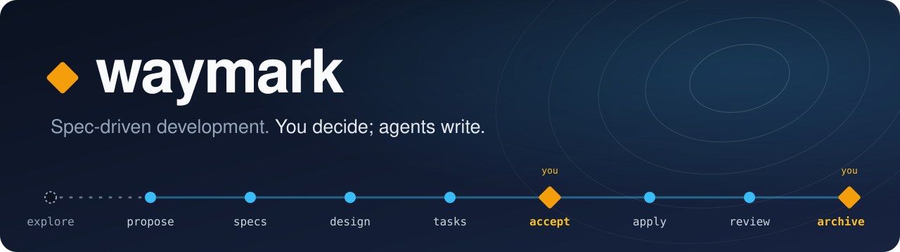

<p align="center">
  
</p>

<p align="center">
  <a href="https://github.com/noahnkr/waymark/actions/workflows/ci.yml"></a>
  <a href="https://pypi.org/project/waymark-cli/"></a>
  
  <a href="LICENSE"></a>
</p>

**Waymark is spec-driven development for people who want to stay in charge while
agents write the code.** Your specs and changes live as plain markdown in the
repository, and a deterministic CLI, `wm`, tells your coding agent what comes
next. It builds on [OpenSpec](https://github.com/Fission-AI/OpenSpec)'s model of
living specs and change deltas, and adds firm points *during* the build.

## See it in action

<!-- generated: evidence -->

A small change, accepted, with its first item built and reviewed:

```console
$ wm status
── Changes in flight ───────────────────────────────────────────────────
  add-result-limit         applying   █████░░░░░ 1/2    → apply 1.2

✓ Nothing needs you.
```

Its task list. The tick and the review line under 1.1 were written by `wm`, not by an agent:

```markdown
# Tasks

## 1. Limit

- [x] 1.1 Cap the result count
  - Criteria: at most fifty results come back
  - Verify: a test searches an index with fifty-one matches
  - (self-review) 2026-01-15: the cap holds at fifty; the fifty-one-match test passes
- [ ] 1.2 Mention the limit in the help text   `review: none`
  - Criteria: the search help names the limit
```

<details>
<summary>The rest of the change</summary>

```
waymark/changes/add-result-limit/proposal.md
waymark/changes/add-result-limit/specs/search.md
waymark/changes/add-result-limit/tasks.md
```

Your approval, written into the proposal by `wm accept`: `Accepted: 2026-01-15 by Alex Example (fingerprint: d042f9b4cd32eca7)`

</details>

<sub>Real output of this version of <code>wm</code> on a generic change, generated by <code>tools/docs.py</code>. From 0.1.1 it comes from Waymark's own record.</sub>

<!-- end of generated evidence -->

## Why Waymark

- **Agents only know what's written down.** Each item is built by a fresh agent
  from the record alone. If the record isn't enough, it reports a spec gap
  instead of guessing.
- **Review is recorded.** Every item is checked at its level (a self-check, an
  independent reviewer that never saw the build, or none), and the check is
  written under it. Archiving refuses unreviewed work.
- **Pick up anywhere.** There is no stored status: `wm` works out where things
  stand from the files and git, in any session, on any machine.
- **You stay in charge.** Agents draft every artifact and write the code. You
  approve each change before it's built, and again when it's archived.
- **Light when the work is small.** A small change is a proposal, a task list
  and two approvals.

In Claude Code, these rules are enforced by hooks, not just asked for. See
[what's enforced, and where](#whats-enforced-and-where).

## Quick start

```
pipx install waymark-cli     # or: uv tool install waymark-cli
cd your-project
wm init
```

Then, in Claude Code:

- **`/wm-kickoff`** drafts your project's charter with you.
- **`/wm-onboard`** takes one real, small change on your own code through every step.

From then on: `/wm-propose` to start a change, `/wm-apply` to build it,
`/wm-archive` to finish it. `wm status` shows where things stand, and `wm inbox`
shows what needs you. Note that the package is `waymark-cli`; the command is `wm`.

<details>
<summary><strong>Who it's for</strong></summary>

<br>

- **Solo developers** building real projects with coding agents.
- **Small teams** (roughly two to five) sharing one record across branches.
- **Projects split across repositories,** such as a frontend and a backend, with
  one record in an *atlas* ([guide](docs/multi-repo.md)).
- **New and existing codebases.** Specs grow where work happens; nothing is
  reverse-engineered up front.

It's not for handing over a goal and walking away, for throwaway scripts, or for
organizations that need access control or approval chains.

</details>

<details>
<summary><strong>What it costs</strong></summary>

<br>

Agents write every artifact and all the code, on your own agent tool and plan;
`wm` never calls a model. You approve each change twice, and settle what
`wm inbox` lists: spec gaps, blocked items, reviews that failed twice. Time and
token figures will come from using Waymark on itself, in 0.1.1. None are
claimed before they're measured.

</details>

<details>
<summary><strong>What's enforced, and where</strong></summary>

<br>

| Enforced by | What | Holds in |
|---|---|---|
| `wm`, the git hooks and CI | Nothing is built before acceptance; archive refuses unbuilt or unreviewed items; conflicting changes are caught; record health; commit-message format | Every agent tool |
| Claude Code's hooks | Only you accept a change or override a missing review; implementers edit only code (in their item's repo) and their notes; reviewers edit nothing; delegated agents can't commit, push or write the record; results are recorded from the agents' own words | Claude Code |

These are guard rails against mistakes and shortcuts, not security against
someone set on getting around them.

**Teams:** each change has one owner and its own branch. Two changes that touch
the same requirement are reported, and the second must be revised before it's
archived. Conflicts are caught on the merged tree, not before merge. The
independent reviewer is always an agent.

</details>

## Learn more

- **[Getting started](docs/getting-started.md)**: from install to your first change
- **[Concepts](docs/concepts.md)**: the workflow, the files, the roles, and a glossary
- **[Multi-repo guide](docs/multi-repo.md)**: one record for several repositories
- **[CLI](docs/cli.md)** and **[JSON](docs/json.md)** references, generated from the code
- **[Architecture](docs/architecture.md)**: for contributors, including how to add an agent tool
- **[Changelog](CHANGELOG.md)**

Works with Claude Code. Version last verified: **pending the 0.1.0 smoke test**.

## License

[MIT](LICENSE)
